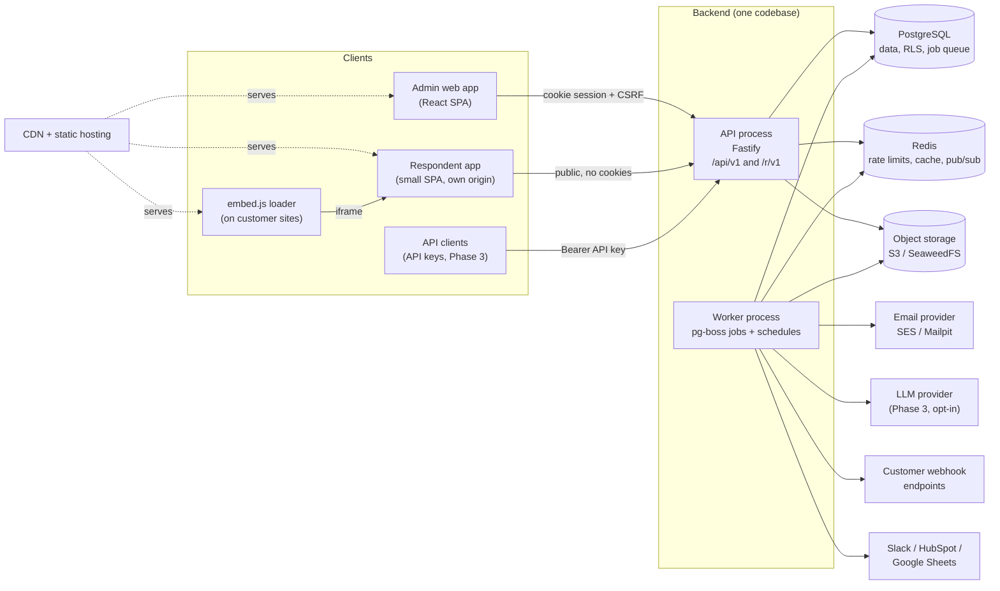
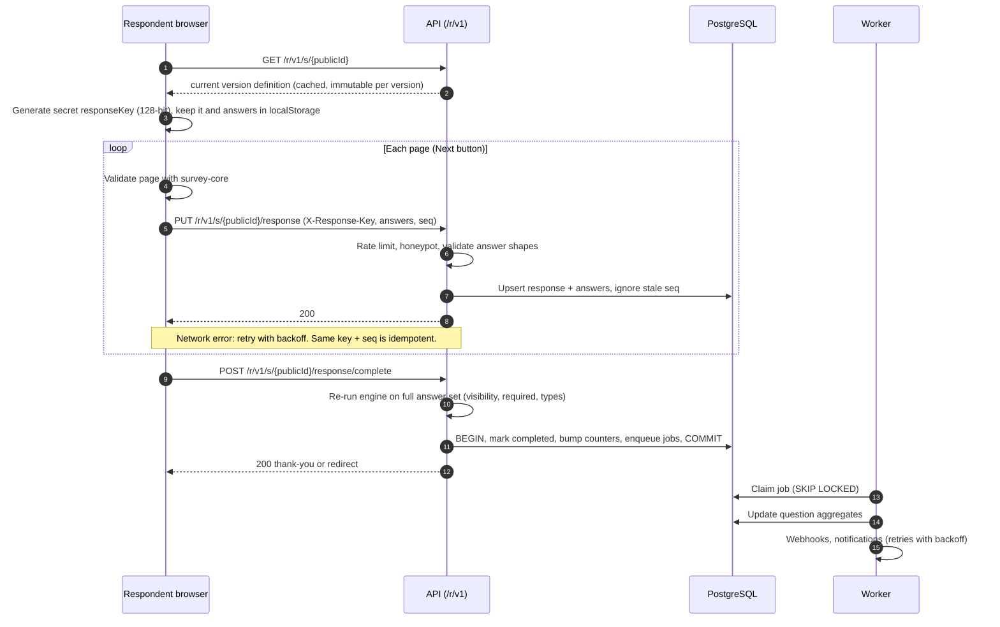
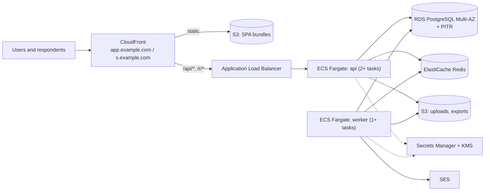

# 1. Architecture Overview

> Status: draft for approval. Assumptions are tagged **[A#]** and listed in [README](README.md#assumptions).

## 1.1 Shape of the system

A **modular monolith**: one backend codebase (TypeScript), deployed as two processes (HTTP API and background
worker), backed by PostgreSQL. Two frontends: an admin app and a deliberately small respondent app.

Why not microservices: the domain is cohesive (surveys → responses → analytics), the scale target **[A2]** fits
comfortably on one Postgres primary, and a monolith with clear module boundaries is cheaper to build, test and
operate. Modules are separated so that hot paths (response ingest, analytics) can be split out later without
rewriting them.

## 1.2 Recommended stack

| Layer | Choice | Why | Alternatives considered |
|---|---|---|---|
| Language | **TypeScript everywhere** (Node 24 LTS) | The logic/validation engine must behave *identically* in the builder preview, the respondent's browser and the server. One language means one implementation. | Django + React: engine would exist twice (Python + TS) and drift. |
| Admin frontend | React 19 + Vite, React Router, TanStack Query, Tailwind CSS + Radix UI primitives, dnd-kit, Recharts | Mainstream and accessible. dnd-kit supports keyboard drag-and-drop, which WCAG needs. | Next.js: server rendering adds little to a logged-in app. |
| Respondent frontend | Separate small Vite + React app on its **own origin**, ≤ 100 KB gzipped JS | Meets the 2 s on 4G budget. A separate origin means a bug in survey content can never reach admin session cookies. | Preact (fallback if over budget). Server-rendered pages (later, if LCP misses target). |
| API | **Fastify 5**, one module per area (auth, org, surveys, distribution, respondent, results), explicit capability checks per route | Small, fast, and works with the same TypeScript toolchain as everything else (tsx, Vite, Vitest). *Changed during Phase 1 from NestJS:* NestJS dependency injection needs decorator metadata, which esbuild-based tools (tsx, Vite, Vitest) don't emit, so every tool would have needed an SWC workaround. | NestJS (structure via DI; see the reason above). |
| Validation | Zod schemas in shared packages | One schema serves client forms, API validation and OpenAPI generation. | class-validator: can't be shared with the browser. |
| Database | PostgreSQL 17 | Relational + JSONB + row-level security + strong aggregation. | MySQL (no RLS). MongoDB (weak for cross-tabs and joins). |
| Data access | Drizzle ORM, raw SQL for analytics | Thin, typed and SQL-shaped. Easy to run every request inside a tenant-scoped transaction. | Prisma: heavier, and RLS needs a per-query transaction workaround. |
| Background jobs | **pg-boss** (job queue stored in Postgres) | Jobs are enqueued **in the same transaction** as the data that triggers them, so a committed response can't lose its webhooks or aggregation. | BullMQ on Redis: needs an outbox table to get the same guarantee. |
| Cache, rate limits, pub/sub | Redis 7 | Rate limiting, published-definition cache, live dashboard fan-out (Phase 2). | — |
| Object storage | S3 (SeaweedFS locally), from Phase 2A | File uploads and logos (exports later). Uploads pass through the API (see 03 §3.10). | — |
| Email | Amazon SES (Mailpit locally), behind an `EmailSender` interface | Low cost, bounce/complaint feeds. | Postmark/SendGrid: nicer DX, higher cost. Easy swap. |
| Auth | Own email + password auth, server-side sessions, argon2id. SSO in Phase 3. | Small surface area, full control over the multi-org model. | Auth0/Clerk: per-user cost, and their tenancy model leaks into ours. |
| Testing | Vitest, a dedicated Postgres test database (from docker compose), Playwright, axe-core, Lighthouse, a Node perf script | Real database in integration tests catches RLS and SQL mistakes that mocks hide. | Jest. Cypress. Testcontainers (slower on Windows, no gain over the compose database). k6 (an extra binary; the Node script measures the same thing). |
| Observability | pino (JSON logs), Sentry, OpenTelemetry metrics | Standard, vendor-neutral. | — |
| Monorepo | pnpm workspaces | Simple. Add Turborepo only if build times hurt. | Nx: more tooling than we need. |

## 1.3 Component diagram



### Components

| Component | Responsibility |
|---|---|
| **Admin web app** | Survey builder, distribution, results and analytics, collaboration, org administration. Talks only to `/api/v1`. |
| **Respondent app** | Renders a published survey, runs the logic engine client-side, autosaves per page, retries submissions. Also runs inside the builder as the **live preview** (in an iframe, desktop and 390 px mobile widths), so the preview is exactly what respondents see. |
| **embed.js** | A tiny loader (< 5 KB) that injects the respondent app as an inline or popup iframe on a customer's site. Iframe isolation avoids CSS/JS clashes with the host page. |
| **API process** | Stateless HTTP. Two surfaces: `/api/v1` (authenticated: admin app and API keys) and `/r/v1` (public respondent endpoints, separately rate-limited). Generates OpenAPI from the Zod contracts. |
| **Worker process** | Same codebase, different entrypoint. Runs jobs: analytics aggregation, email sends and reminders, webhook delivery, exports, scheduled reports, retention purges, AI summaries. |
| **`survey-core` package** | Pure TypeScript, no I/O: the survey definition schema, logic engine (visibility, navigation), answer validation, piping. Used by builder, respondent app and API. The most heavily unit-tested code in the system. |
| **PostgreSQL** | System of record, tenant isolation (RLS) and the job queue. |
| **Redis** | Ephemeral only: losing Redis never loses data. |

## 1.4 Key data flows

### a) Build and publish

1. A creator edits a **draft version**. The builder autosaves the whole definition document (debounced) with an
   optimistic-concurrency `revision`. Two editors who collide get a `409` and a "reload or overwrite" prompt.
2. Every save runs `survey-core` validation: structural errors block the save, semantic problems (e.g. a choice
   question with no options) are returned as warnings.
3. **Publish** re-validates strictly, freezes the draft as an immutable **published version** and points
   `surveys.current_version_id` at it. Editing a live survey later creates a new draft copied from the current
   version (see [Data model §2.4](02-data-model.md#24-versioning)).
4. Publish writes an audit event and (Phase 3) enqueues `survey.published` webhooks in the same transaction.

### b) Respond and submit (reliability path)



**Guarantee, stated precisely:** once the API acknowledges a save, it is durable (Postgres commit, with point-in-time
recovery in production). Before acknowledgement, answers live in the respondent's localStorage and are retried, on
the spot and again on the next visit. The server never trusts client-side validation: on completion it recomputes
which questions were visible, discards answers to hidden ones and enforces required/format rules.

> **Deliberate deviation:** the brief says "queue + retry". Putting a Redis queue in front of Postgres would make
> Redis the durability point, which is weaker. Instead the *client* holds the retry queue, Postgres is the durable
> store, and side effects use transactional jobs. If you need submissions accepted **during a Postgres outage**, add
> an SQS buffer at ingest later. That's flagged in [risks](05-risks.md).

### c) Analytics read path

- **Unfiltered dashboard:** reads pre-aggregated `question_counts` (maintained by the worker) plus cheap
  indexed counts on `responses`. Fast whatever the response volume.
- **Filtered, segmented or cross-tab:** a live SQL query over `answers` using `(survey_id, question_key)`
  indexes. About 1–2.5 M answer rows for a 50 k-response survey, which Postgres groups well inside the 5 s budget.
  Results are cached in Redis under a key that changes on every new completion, so the cache never goes stale.
- A nightly job (and an on-demand "rebuild") recomputes aggregates from raw answers to correct any drift.
- "Real-time": Phase 1 polls every 15 s. Phase 2 pushes updates over Server-Sent Events via Redis pub/sub.

### d) Email campaigns (Phase 2)

CSV import job → contacts and list → campaign is scheduled as a pg-boss job → the worker sends in batches through
SES with per-recipient unique tokens → SES bounce/complaint notifications update recipient status → a daily
reminder job targets recipients who haven't responded, up to the campaign's reminder limit.

### e) Outgoing webhooks (Phase 3)

The domain event is enqueued in the triggering transaction. The worker signs the payload with HMAC-SHA256 and
POSTs it. It retries with exponential backoff (about 7 attempts over 48 h), records every delivery attempt, and
auto-disables an endpoint after repeated failures, notifying org admins.

## 1.5 Authentication and authorization

**Authentication**

- Admin app: email + password (argon2id), opaque session id in a `__Host-` cookie (`HttpOnly; Secure;
  SameSite=Lax`), sessions stored in Postgres. CSRF: double-submit token in an `X-CSRF-Token` header on every
  state-changing request. Login is rate-limited per account and per IP.
- Public API (Phase 3): `Authorization: Bearer sk_…` API keys. Only a hash is stored. Keys are scoped per org and
  per permission. No cookies, so no CSRF.
- Respondents: anonymous by default. Personalised email links carry a recipient token (Phase 2). Login-required
  surveys come in Phase 3 (see open question Q5).
- SSO (SAML/OIDC): Phase 3.

**Authorization: two layers, combined**

1. **Org role** (per membership): `org_admin`, `creator`, `analyst`. Platform-level `super_admin` is a user flag,
   not an org role.
2. **Survey role** (per survey, via sharing): `owner`, `editor`, `viewer`.

Effective survey permission = the survey role, **capped** by the org role, with org admins implicitly `owner` on
every survey in their org.

| Capability | super_admin | org_admin | creator | analyst |
|---|---|---|---|---|
| Manage orgs, plans, global templates | ✅ | — | — | — |
| Read an org's survey data | ❌ by default (audited "support access" later) | ✅ all surveys | shared surveys only | shared surveys only |
| Manage members, roles, branding, retention | — | ✅ | — | — |
| Create surveys | — | ✅ | ✅ (becomes owner) | — |
| Max survey role when shared | — | owner | owner | **viewer** |

| Survey action | owner | editor | viewer |
|---|---|---|---|
| View results, responses, export (audited) | ✅ | ✅ | ✅ |
| Edit draft, publish, distribute, close/reopen | ✅ | ✅ | — |
| Delete responses | ✅ | ✅ | — |
| Share, transfer ownership, delete survey | ✅ | — | — |

Enforcement: every route loads the survey through one function that resolves the effective role and checks the
capability it needs (`loadSurvey(tx, auth, id, 'survey.publish')`). A table-driven integration test covers every
capability × role (`apps/api/test/permissions.test.ts`).

## 1.6 Tenant isolation (defence in depth)

1. Every tenant-owned row has `org_id`.
2. **PostgreSQL row-level security** on every tenant table: `org_id = current_setting('app.org_id')::uuid`.
   The app connects as a role **without** `BYPASSRLS`. Each request runs in a transaction that sets
   `app.org_id` with `SET LOCAL`, which works with PgBouncer in transaction mode. If the setting is missing, no
   rows match: the system **fails closed**.
3. Repositories require an `orgId` argument, so the application layer filters too.
4. Public respondent routes resolve `publicId → (org_id, survey_id)` through one narrow `SECURITY DEFINER`
   function, then proceed under RLS like everything else.
5. Cross-tenant jobs (retention, usage metrics) use a separate DB role, used only in the worker's admin module.
6. Integration tests assert that org A's credentials can't read, list or modify org B's rows through any
   endpoint.

## 1.7 Security and privacy controls

| Concern | Control |
|---|---|
| Injection | Parameterised queries only (Drizzle / tagged `sql`). No string-built SQL. Lint rule blocks `sql.raw` outside reviewed files. |
| XSS | Survey text is plain text plus a restricted markdown subset, rendered via an allow-list sanitizer. Piped values are always inserted as text, never HTML. Strict CSP on both apps. Respondent app on a separate origin. |
| CSRF | Double-submit token on cookie-authenticated routes. Respondent API uses no cookies. |
| CSV/XLSX formula injection | Export cells starting with `= + - @ \t \r` are prefixed with `'`. |
| SSRF (webhooks, integrations) | Resolve DNS and block private, link-local and metadata IP ranges at send time. HTTPS only in production. |
| Secrets | Webhook secrets and integration tokens encrypted with AES-256-GCM using envelope keys (AWS KMS in production, a key from env locally). API keys and tokens stored as SHA-256 hashes. Passwords hashed with argon2id. |
| Abuse | Redis token-bucket rate limits per IP hash and per survey. Honeypot field. Optional Cloudflare Turnstile (Phase 2). IPs are hashed with a daily-rotating salt and **never written to Postgres**. |
| Anonymous mode | Enforced server-side (not just hidden in the UI). See [Data model §2.7](02-data-model.md#27-anonymous-mode). |
| GDPR/CCPA | Consent question type with the consent text version recorded (Phase 2). Per-respondent export and erasure by email or contact (Phase 3). Retention policies with purge jobs (Phase 3). Response deletion from Phase 1. |
| Audit | Append-only `audit_logs` (the app role has no UPDATE/DELETE grant), written from Phase 1. Viewer UI in Phase 3. |
| Logs | Answer values, emails and tokens are never logged. pino redaction list is enforced in tests. |

## 1.8 Performance budgets

| Target | How |
|---|---|
| Respondent page < 2 s on 4G (LCP, p75) | ≤ 100 KB gz JS. Static assets from CDN. The definition fetch starts from an inline script, in parallel with the bundle. The published definition is immutable per version, so it's cached in Redis and over HTTP. System fonts by default (custom fonts use `font-display: swap`). No third-party scripts unless CAPTCHA is enabled. Checked by a Lighthouse CI budget. |
| Analytics on 50 k responses < 5 s | Pre-aggregation for unfiltered views. Covering indexes for filtered queries. Redis result cache. `statement_timeout` on analytics queries. Read replica when needed. Checked against a 50 k-response seed with `pnpm perf:results` (report in `perf/`). |
| Submission API p95 < 300 ms | One transaction per save. No synchronous external calls. Everything else goes to the worker. |

## 1.9 Observability

- **Logs:** pino JSON with `requestId`, `orgId`, `userId`, route, status and latency. Respondent requests log
  `surveyId` only.
- **Errors:** Sentry in the API, worker and both frontends, with release tags and PII scrubbing.
- **Metrics:** submissions/sec, submission error rate, job queue depth and oldest-job age per queue, webhook
  failure rate, analytics query latency, p95 latency per route.
- **Health:** `/healthz` (liveness) and `/readyz` (DB and Redis reachable).

## 1.10 Testing strategy

| Level | Scope | Tools |
|---|---|---|
| Unit | `survey-core`: every question type's validation, condition operators, navigation, piping. Includes property-based tests, e.g. "a hidden question is never required", "navigation always terminates". | Vitest, fast-check |
| Integration | Every API route against a real Postgres. RLS cross-tenant tests. Permission matrix. Idempotent submission replays. | Vitest, Fastify `inject`, Postgres test database |
| Component | Question renderers: keyboard use and axe accessibility checks. | Vitest, Testing Library, axe-core |
| End-to-end | Build → publish → respond (desktop and mobile viewport) → results → CSV export. | Playwright |
| Performance | Submission throughput. Analytics on a 50 k-response seed. | `pnpm perf:results` (Node), Lighthouse (`pnpm --filter @survey/e2e lighthouse`) |

## 1.11 Repository layout

```
survey-management/
├─ apps/
│  ├─ api/              Fastify. Entry points: src/main.ts (HTTP) and src/worker.ts (jobs)
│  │  └─ src/modules/   auth, orgs, surveys, distribution, collect, results, export, audit, …
│  ├─ web/              Admin SPA (builder, results, admin)
│  └─ respondent/       Respondent SPA + embed.js loader (strict bundle budget)
├─ packages/
│  ├─ survey-core/      Definition schema, logic engine, validation, piping. No I/O.
│  ├─ contracts/        Zod request/response schemas shared by api, web, respondent
│  └─ db/               Drizzle schema, SQL migrations (incl. RLS policies), seed scripts
├─ e2e/                 Playwright tests
├─ docker-compose.yml   Postgres, Redis, Mailpit, SeaweedFS (S3), ClamAV (profile `scan`)
└─ docs/
```

## 1.12 Deployment

**Local (Phase 1):** `docker compose up` starts Postgres, Redis and Mailpit. `pnpm dev` runs the API, worker and both
SPAs with hot reload. Vite proxies `/api` and `/r` to the API, so local is same-origin, like production.

**Production (proposed for AWS [A4]; IaC isn't part of Phase 1):**



Both apps are served same-origin with the API through CloudFront path routing, so no CORS is needed for either
app. The embed iframe points at the respondent origin, so it's same-origin too.
