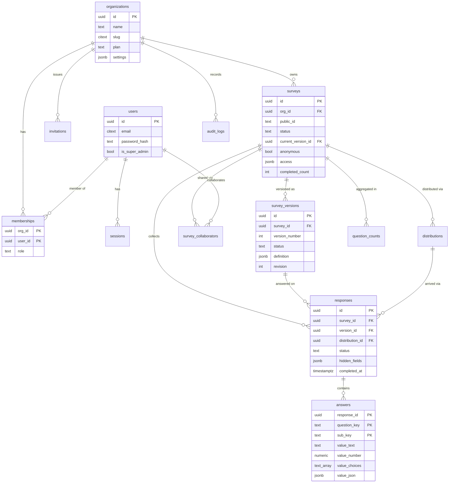
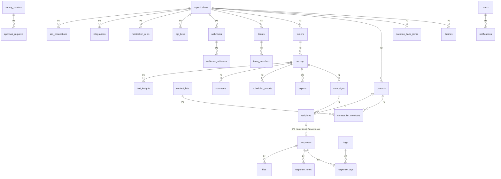
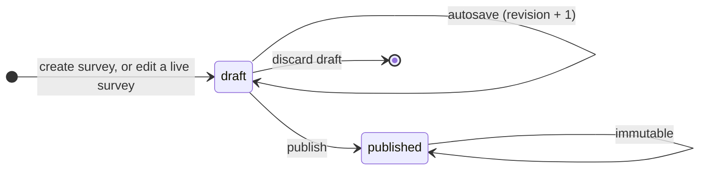
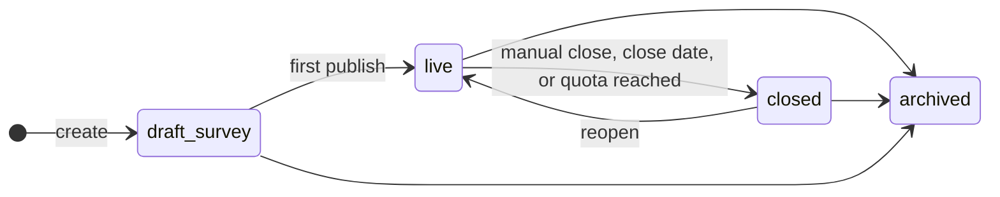

# 2. Data Model

> Status: draft for approval. Phase tags: **P1**, **P2**, **P3**. A table or column tagged P2/P3 is added by
> that phase's migration, not shipped unused in Phase 1.

## 2.1 Conventions

- **IDs:** UUIDv7, generated by the application. Time-ordered values keep B-tree inserts local, and we don't
  depend on Postgres 18's `uuidv7()`. Public-facing identifiers are separate, short random strings (for example
  `surveys.public_id`), so internal IDs never appear in respondent URLs or QR codes.
- **Tenancy:** every tenant-owned table has `org_id uuid not null`, with row-level security (§2.9). `users` is
  global, because one person can belong to several orgs. Access to it goes through `memberships`.
- **Timestamps:** `timestamptz`, stored in UTC.
- **Deletes:** surveys are soft-deleted (`deleted_at`) and purged later. Responses and answers are
  **hard-deleted**, because a privacy erasure must really erase.
- **Stable keys inside survey content:** pages, questions, options and matrix rows have short random keys
  (`q_7Hk2pX`). They never change and are never reused. Answers, logic, translations and analytics reference keys,
  never labels or positions.

## 2.2 Entity-relationship diagrams

### Core (Phase 1)



### Later phases



## 2.3 Survey content: one versioned JSON document

The brief lists `pages`, `questions`, `options` and `logic_rules` as entities. They exist in this design as
**typed structures inside one validated JSON document per survey version** (`survey_versions.definition`), not as
separate tables.

**Why:**

| | JSON document per version (chosen) | Normalised tables |
|---|---|---|
| Versioning | Copy one document. A published row is frozen. | Deep-copy pages, questions, options and rules on every publish. |
| Builder saves | One atomic write with an optimistic `revision`. | Dozens of row inserts, updates and reorders per drag-and-drop. |
| Logic engine | The same document runs in the builder, the respondent app and the server. | Must be reassembled into a document anyway. |
| Referential integrity | Enforced by the `survey-core` validator on every save and publish. | Foreign keys. |
| Cross-survey SQL over questions | Harder. Not a requirement. The question bank stores question snippets. | Easy. |

The cost is that the database can't enforce "logic rule X references an existing question". The validator does,
and `survey-core` is the most heavily tested package (see [testing](01-architecture.md#110-testing-strategy)). If we
ever need SQL over questions, we can project a read-only `version_questions` table on publish without changing
anything else.

### Definition schema (Zod-backed, abbreviated)

```ts
type SurveyDefinition = {
  schemaVersion: 1;
  defaultLocale: string;                 // "en"
  pages: Page[];
  hiddenFields: HiddenField[];           // declared URL params; undeclared params are ignored
  logic: NavigationRule[];               // P2
  settings: {
    showProgressBar: boolean;
    allowBack: boolean;
    thankYou: { title: string; body: string; redirectUrl?: string };  // redirect: P2
  };
};

type HiddenField = { key: string; label?: string; nonIdentifying?: boolean };  // see anonymous mode

type Page = {
  key: string;
  title?: string;
  description?: string;
  elements: Element[];                   // questions and text blocks, in display order
  visibleIf?: Condition;                 // P2
};

type Element = Question | TextBlock;
type TextBlock = { kind: 'text'; key: string; body: string; visibleIf?: Condition };  // restricted markdown

type Question = {
  kind: 'question';
  key: string;                           // stable; never reused with a different type
  type: QuestionType;
  title: string;                         // may contain piping tokens (P2): {{q.q_7Hk2}} {{param.source}} {{contact.first_name}}
  helpText?: string;
  required: boolean;
  visibleIf?: Condition;                 // P2
  options?: Option[];                    // choice-like types, ranking, matrix columns
  rows?: Option[];                       // matrix rows (P2)
  config: QuestionConfig;                // discriminated by `type`, see §2.5
};

type Option = {
  key: string;
  label: string;
  value?: number;                        // ordinal for likert/scored options
  isOther?: boolean;                     // "Other" with free text
  exclusive?: boolean;                   // "None of the above" deselects the rest
};

// Conditions (P2): AND / OR / NOT, nested up to depth 3 (validator-enforced)
type Condition =
  | { all: Condition[] }
  | { any: Condition[] }
  | { not: Condition }
  | { source: { question: string; sub?: string } | { hidden: string }; op: Operator; value?: unknown };

type Operator =
  | 'answered' | 'not_answered'
  | 'eq' | 'neq' | 'in' | 'not_in'                    // single value
  | 'contains_any' | 'contains_all' | 'contains_none' // multi-select
  | 'gt' | 'gte' | 'lt' | 'lte' | 'between'           // numeric and date
  | 'text_contains';

// Evaluated in order when the respondent leaves `afterPage`; the first match wins, default is the next page.
type NavigationRule = {
  id: string;
  afterPage: string;
  when: Condition;
  then: { goTo: string } | { end: { disqualify?: boolean; message?: string } };
};
```

**Validator rules (enforced on save and publish):**

- Keys are unique within the document.
- Conditions only reference questions on **earlier pages**, or earlier in the same page for `visibleIf`, so there
  are no cycles.
- `goTo` only jumps **forward**.
- Operators match the source question's type.
- Choice questions have at least two options.
- `min ≤ max`.
- Piping tokens only reference earlier questions or declared hidden fields.
- Publish additionally checks that no question key changed type compared with any earlier published version
  (changing a question's type in the builder generates a new key).

## 2.4 Versioning





How it works:

1. A survey has **at most one draft version** (partial unique index) and any number of published versions.
   `surveys.current_version_id` points to the latest published version.
2. **Published versions are immutable.** A database trigger rejects changes to `definition` once
   `status = 'published'`. The application isn't trusted to remember this.
3. **Editing a live survey** creates a new draft copied from the current version, keeping every key. The live
   survey keeps serving the current version until the draft is published as version N+1.
4. **Each response stores `version_id`.** A respondent who started on v3 finishes on v3, even if v4 is published
   mid-way, and resuming loads v3.
5. **Analytics across versions** group by `question_key` and option key. Labels come from the newest version that
   contains the key. Options deleted in later versions still show their historical counts, marked "(removed)".
   Results can also be filtered to one version.
6. **Drafts use optimistic concurrency:** `PUT /draft` sends `If-Match: <revision>`. A mismatch returns `409` with
   the current revision. Real-time co-editing is out of scope ([risks](05-risks.md)).
7. Translations (P3) live alongside the definition. They can be edited on a published version because they can't
   change structure or keys. This is a deliberate, audited exception to immutability.

## 2.5 How answers are stored

**One row per answer "cell"** in `answers`, with typed columns. Most types use one row per question. Matrix and
ranking use one row per sub-item (`sub_key`), so a matrix heatmap or a ranking average is the same `GROUP BY` as a
bar chart.

| Question type | Phase | API answer value | Stored as |
|---|---|---|---|
| `single_choice`, `dropdown` | P1 | `"opt_a"` or `{ option: "opt_other", other: "text" }` | `value_choices = {opt_a}`, `other_text` |
| `multi_choice` | P1 | `["opt_a","opt_c"]` (+ `other`) | `value_choices = {opt_a,opt_c}`, `other_text` |
| `likert` (single statement) | P1 | `"opt_agree"` | `value_choices = {opt_agree}`, `value_number` = option ordinal |
| `rating` (stars, 3–10 points) | P1 | `4` | `value_number` |
| `nps` | P1 | `0`–`10` | `value_number` |
| `short_text`, `long_text` | P1 | `"…"` | `value_text` (length-limited per config) |
| `email` | P1 | `"a@b.co"` | `value_text`, normalised |
| `date` | P1 | `"2026-11-23"` | `value_date`, plus `value_text` as the canonical ISO string |
| `matrix` (single or multi per row) | P2 | `{ "row_1": "col_b", "row_2": ["col_a"] }` | one row per matrix row: `sub_key = row`, `value_choices = {cols}` |
| `ranking` | P2 | `["opt_c","opt_a","opt_b"]` | one row per option: `sub_key = option`, `value_number = rank` |
| `slider` | P2 | `37.5` | `value_number` |
| `date` with time / datetime | P2 | `"14:30"` / ISO datetime | `value_text` (+ `value_date` for the date part) |
| `phone` | P2 | `"+14155550123"` | `value_text`, normalised to E.164 |
| `file_upload` | P2 | `["file_…"]` | `value_json = [{fileId}]`, files linked in `files` |
| `consent` | P2 | `true` | `value_number = 1`, plus `value_text` = consent-text hash (proves what was agreed to) |
| text block | P1 | — | not stored |

Why not a single `jsonb` answers blob per response? It's simpler to write, but filters, segments and cross-tabs
(the core of analytics) become JSON path scans with poor indexing. The typed-cell table indexes well, and a
response's answers are still one indexed lookup away for the response viewer.

## 2.6 Schema: Phase 1 tables

```sql
-- ── Identity and tenancy ─────────────────────────────────────────────
create table organizations (
  id          uuid primary key,
  name        text not null,
  slug        citext not null unique,
  plan        text not null default 'free',           -- limits only; no billing provider [A5]
  status      text not null default 'active' check (status in ('active','suspended')),
  settings    jsonb not null default '{}',            -- branding P2, approval/retention P3
  created_at  timestamptz not null default now(),
  updated_at  timestamptz not null default now()
);

create table users (                                   -- global: not tenant-scoped
  id                uuid primary key,
  email             citext not null unique,
  name              text not null,
  password_hash     text,                              -- argon2id; null for SSO-only users (P3)
  is_super_admin    boolean not null default false,
  email_verified_at timestamptz,
  last_login_at     timestamptz,
  disabled_at       timestamptz,
  created_at        timestamptz not null default now()
);

create table memberships (
  org_id     uuid not null references organizations(id) on delete cascade,
  user_id    uuid not null references users(id) on delete cascade,
  role       text not null check (role in ('org_admin','creator','analyst')),
  created_at timestamptz not null default now(),
  primary key (org_id, user_id)
);

create table invitations (
  id          uuid primary key,
  org_id      uuid not null references organizations(id) on delete cascade,
  email       citext not null,
  role        text not null check (role in ('org_admin','creator','analyst')),
  token_hash  bytea not null unique,                   -- sha256; the raw token only goes out in the email
  invited_by  uuid not null references users(id),
  expires_at  timestamptz not null,
  accepted_at timestamptz,
  revoked_at  timestamptz,
  created_at  timestamptz not null default now()
);

create table sessions (
  id_hash       bytea primary key,                     -- sha256 of the cookie value
  user_id       uuid not null references users(id) on delete cascade,
  active_org_id uuid references organizations(id),
  ip            inet,                                  -- admin users only; never respondents
  user_agent    text,
  created_at    timestamptz not null default now(),
  last_seen_at  timestamptz not null default now(),
  expires_at    timestamptz not null
);

create table auth_tokens (                             -- password reset, email verification
  token_hash bytea primary key,
  user_id    uuid not null references users(id) on delete cascade,
  purpose    text not null check (purpose in ('password_reset','email_verify')),
  expires_at timestamptz not null,
  used_at    timestamptz
);

-- ── Surveys ──────────────────────────────────────────────────────────
create table surveys (
  id                 uuid primary key,
  org_id             uuid not null references organizations(id),
  title              text not null,
  public_id          text not null unique,             -- 10-char base62, used in /s/{public_id}
  status             text not null default 'draft'
                     check (status in ('draft','live','closed','archived')),
  current_version_id uuid,                             -- FK added after survey_versions exists
  anonymous          boolean not null default false,   -- changeable only while 0 responses exist
  access             jsonb not null default '{}',      -- { closesAt, opensAt(P2), quota, onePerBrowser, passwordHash(P2), onePerRecipient(P2) }
  completed_count    integer not null default 0,       -- maintained synchronously; used for quotas
  closed_reason      text,                             -- 'manual' | 'close_date' | 'quota'
  theme_id           uuid,                             -- P2; presentation is NOT versioned
  folder_id          uuid,                             -- P3
  is_template        boolean not null default false,   -- P2
  created_by         uuid not null references users(id),
  created_at         timestamptz not null default now(),
  updated_at         timestamptz not null default now(),
  deleted_at         timestamptz
);
create index surveys_org_list on surveys (org_id, updated_at desc) where deleted_at is null;

create table survey_versions (
  id             uuid primary key,
  org_id         uuid not null,
  survey_id      uuid not null references surveys(id) on delete cascade,
  version_number integer not null,
  status         text not null check (status in ('draft','published')),
  definition     jsonb not null,
  translations   jsonb not null default '{}',          -- P3: { "fr": { "q_7Hk2.title": "…" } }
  revision       integer not null default 0,           -- optimistic lock for drafts
  created_by     uuid not null references users(id),
  published_by   uuid references users(id),
  published_at   timestamptz,
  created_at     timestamptz not null default now(),
  updated_at     timestamptz not null default now(),
  unique (survey_id, version_number)
);
create unique index survey_versions_one_draft on survey_versions (survey_id) where status = 'draft';
alter table surveys add foreign key (current_version_id) references survey_versions(id);
-- trigger survey_versions_immutable: raise if OLD.status = 'published' and definition changes or status changes

create table survey_collaborators (
  org_id     uuid not null,
  survey_id  uuid not null references surveys(id) on delete cascade,
  user_id    uuid not null references users(id) on delete cascade,   -- P3: or team_id
  role       text not null check (role in ('owner','editor','viewer')),
  added_by   uuid references users(id),
  created_at timestamptz not null default now(),
  primary key (survey_id, user_id)
);
create unique index survey_one_owner on survey_collaborators (survey_id) where role = 'owner';
create index survey_collaborators_user on survey_collaborators (org_id, user_id);

-- ── Distribution ─────────────────────────────────────────────────────
create table distributions (
  id                    uuid primary key,
  org_id                uuid not null,
  survey_id             uuid not null references surveys(id) on delete cascade,
  channel               text not null check (channel in ('link','embed','email')),  -- embed/email: P2
  name                  text not null,                 -- "Default link", "Newsletter Nov", …
  token                 text not null unique,          -- ?d=token for attribution; default link has none in URL
  is_default            boolean not null default false,
  preset_hidden_fields  jsonb not null default '{}',   -- e.g. { "source": "newsletter" }
  config                jsonb not null default '{}',   -- embed mode, popup trigger (P2)
  created_by            uuid not null references users(id),
  created_at            timestamptz not null default now(),
  disabled_at           timestamptz
);

-- ── Responses ────────────────────────────────────────────────────────
create table responses (
  id                  uuid primary key,                -- server-generated
  org_id              uuid not null,
  survey_id           uuid not null references surveys(id) on delete cascade,
  version_id          uuid not null references survey_versions(id),
  distribution_id     uuid references distributions(id),
  response_key_hash   bytea not null,                  -- sha256 of the client's secret key (idempotency + resume)
  status              text not null check (status in ('in_progress','completed','disqualified')),
  is_test             boolean not null default false,  -- preview/test submissions, excluded by default
  seq                 integer not null default 0,      -- last applied client save; stale retries ignored
  furthest_page_key   text,                            -- drop-off by page
  last_question_key   text,                            -- drop-off by question (P2 UI)
  locale              text not null,
  hidden_fields       jsonb not null default '{}',     -- only declared keys, values ≤ 500 chars
  device_type         text check (device_type in ('mobile','tablet','desktop')),
  quality_flags       text[] not null default '{}',    -- P2: 'too_fast', 'straight_lined', …
  started_at          timestamptz not null,            -- hour precision when anonymous
  last_activity_at    timestamptz not null,
  completed_at        timestamptz,                     -- hour precision when anonymous
  duration_ms         integer,
  recipient_id        uuid,                            -- P2; always null when anonymous
  respondent_user_id  uuid,                            -- P3 (login-required surveys); null when anonymous
  country             text,                            -- P2 optional (GeoIP at ingest); never when anonymous
  unique (survey_id, response_key_hash)
);
create index responses_survey_status on responses (survey_id, status, completed_at);
create index responses_survey_started on responses (survey_id, started_at);

create table answers (
  org_id        uuid not null,
  survey_id     uuid not null,                         -- denormalised: analytics never joins to responses
  response_id   uuid not null references responses(id) on delete cascade,
  question_key  text not null,
  sub_key       text not null default '',              -- matrix row / ranking option; '' otherwise
  value_text    text,
  value_number  numeric,
  value_choices text[],
  value_date    date,
  value_json    jsonb,
  other_text    text,
  updated_at    timestamptz not null default now(),
  primary key (survey_id, response_id, question_key, sub_key)   -- includes survey_id: partition-ready
);
create index answers_by_question on answers (survey_id, question_key, sub_key)
  include (response_id, value_choices, value_number);
create index answers_by_response on answers (response_id);

-- ── Analytics pre-aggregation ────────────────────────────────────────
create table question_counts (
  org_id       uuid not null,
  survey_id    uuid not null references surveys(id) on delete cascade,
  version_id   uuid not null,
  question_key text not null,
  sub_key      text not null default '',
  bucket       text not null,       -- option key, numeric value, rank, or '__answered__'
  count        integer not null default 0,
  primary key (survey_id, version_id, question_key, sub_key, bucket)
);

-- ── Audit ────────────────────────────────────────────────────────────
create table audit_logs (
  id          bigint generated always as identity primary key,
  org_id      uuid,                                    -- null for platform events
  actor_type  text not null check (actor_type in ('user','api_key','system')),
  actor_id    uuid,
  action      text not null,                           -- 'survey.published', 'responses.exported', …
  entity_type text,
  entity_id   uuid,
  metadata    jsonb not null default '{}',             -- never answer values
  ip          inet,                                    -- admin actor IP only
  created_at  timestamptz not null default now()
);
create index audit_logs_org_time on audit_logs (org_id, created_at desc);
-- app role: INSERT and SELECT only; no UPDATE or DELETE grant

-- pg-boss creates and manages its own `pgboss` schema for jobs.
```

## 2.7 Anonymous mode

"Genuinely stores no identifying data" is enforced in the server and the database, not just hidden in the UI.

| Rule | Enforcement |
|---|---|
| `surveys.anonymous` can only change while the survey has 0 responses | API check + test |
| No link between a response and a person: `recipient_id`, `respondent_user_id` and `country` stay null | API ingest + DB `CHECK` via trigger on insert |
| Email campaigns still work: the recipient row is marked "responded" (so reminders stop) **without** storing which response it was | Separate update in the same transaction; no foreign key |
| `started_at` / `completed_at` truncated to the hour (duration kept), so send times can't be correlated with responses | Ingest |
| Hidden fields: only those marked `nonIdentifying` are accepted. The builder warns on others. | Ingest drops undeclared or identifying keys |
| `email`, `phone`, `file_upload` question types can't be published in an anonymous survey | Publish validator error |
| IPs are never written to Postgres. Rate limiting uses Redis keys with salted hashes and a ≤ 24 h TTL. | Applies to *all* surveys, not just anonymous ones |
| Respondents see "This survey is anonymous" | Respondent app |

What remains, stated honestly: respondents can type identifying details into free-text answers, and very small
audiences can be re-identified from aggregates. Phase 2 adds an optional "minimum group size" for segments.

## 2.8 Later-phase tables (summary)

| Table | Phase | Key columns |
|---|---|---|
| `themes` | P2 | `org_id, name, tokens jsonb (colors, font, logo_file_id, radius), is_default` |
| `global_templates` | P2 | `name, category, definition jsonb`. Not tenant-scoped; managed by super admin. Org templates are `surveys.is_template = true`. |
| `question_bank_items` | P2 | `org_id, question jsonb, tags text[], created_by, usage_count` |
| `contacts` | P2 | `org_id, email citext, first_name, last_name, attributes jsonb, unsubscribed_at, bounced_at`. Unique `(org_id, email)`. |
| `contact_lists`, `contact_list_members` | P2 | `org_id, name` / `list_id, contact_id` |
| `contact_imports` | P2 | `org_id, file_id, status, total, imported, skipped, errors jsonb` |
| `campaigns` | P2 | `org_id, survey_id, distribution_id, list_id, subject, body, scheduled_at, status, reminder_policy jsonb {afterDays, max}` |
| `recipients` | P2 | `org_id, campaign_id, contact_id, token_hash, status (pending, sent, bounced, opened, started, responded), sent_at, reminders_sent, response_id (null if anonymous)` |
| `files` | P2 | `org_id, storage_key, filename, mime, size, sha256, purpose (response_upload, logo, export, import), response_id, scan_status (pending, clean, infected)` |
| `tags`, `response_tags`, `response_notes` | P2 | tags are per survey. `notes: response_id, author_id, body` |
| `exports` | P2 | `org_id, survey_id, requested_by, format (csv, xlsx, pdf), filters jsonb, status, file_id, expires_at` |
| `scheduled_reports` | P2 | `org_id, survey_id, cron, timezone, recipients text[], format, filters` |
| `folders` | P3 | `org_id, parent_id, name`. Depth limited to 3. |
| `teams`, `team_members` | P3 | `org_id, name` / `team_id, user_id`. `survey_collaborators` gains `team_id`. |
| `comments` | P3 | `org_id, survey_id, version_id, anchor_key (question/page key), author_id, body, resolved_at, parent_id` |
| `approval_requests` | P3 | `org_id, survey_id, version_id, requested_by, status (pending, approved, rejected), decided_by, note` |
| `notification_rules`, `notifications` | P3 | rules: `survey_id, kind (new_response, nps_detractor, threshold, closing), config, channels`. Notifications: `user_id, payload, read_at` |
| `webhooks`, `webhook_deliveries` | P3 | `org_id, url, events text[], secret_enc, active, failure_count` / `webhook_id, event_id, attempt, status, http_status, next_attempt_at, duration_ms` |
| `api_keys` | P3 | `org_id, name, prefix, key_hash, scopes text[], created_by, last_used_at, expires_at, revoked_at` |
| `idempotency_keys` | P3 | `org_id, key, request_hash, status, response jsonb, created_at` (24 h TTL) for public API POSTs |
| `integrations` | P3 | `org_id, kind (slack, hubspot, google_sheets), config_enc, status` |
| `sso_connections` | P3 | `org_id, protocol (saml, oidc), metadata_enc, domains text[], enforce` |
| `text_insights` | P3 | `org_id, survey_id, question_key, filters_hash, status, themes jsonb, sentiment jsonb, model, generated_at` |
| `privacy_requests` | P3 | `org_id, subject_email, kind (export, erase), status, completed_at, file_id` |
| `org_usage_monthly` | P3 | `org_id, month, responses, surveys_published, emails_sent, ai_tokens` |

## 2.9 Tenant isolation in the database

```sql
alter table surveys enable row level security;
alter table surveys force row level security;
create policy tenant_isolation on surveys
  using      (org_id = current_setting('app.org_id', true)::uuid)
  with check (org_id = current_setting('app.org_id', true)::uuid);
-- Repeated for every table with org_id (generated by a migration helper; a test asserts none are missing).

-- The only cross-tenant read on a public path:
create function resolve_public_survey(p_public_id text)
returns table (org_id uuid, survey_id uuid)
language sql stable security definer set search_path = public as $$
  select s.org_id, s.id from surveys s where s.public_id = p_public_id and s.deleted_at is null
$$;
```

The application wraps every request in `withTenant(orgId, tx => …)`, which opens a transaction and runs
`select set_config('app.org_id', $1, true)`. An unset value makes `current_setting(..., true)` return null, so no
rows match: the system fails closed.

## 2.10 Aggregates, growth and retention

- **`question_counts`** is incremented by the `response.completed` job and decremented by the response-deletion
  job. Every question also gets an `__answered__` bucket. Text, email, date and file questions only keep
  `__answered__`. Sliders with more than 101 buckets aren't pre-aggregated; they're computed live. A nightly
  `aggregates.rebuild` job recomputes surveys that had activity that day.
- **Response-level stats** (started, completed, completion rate, average and median duration, drop-off) are
  computed live from `responses`. For 50 k rows that's an index scan of tens of milliseconds, so they're not worth
  pre-aggregating.
- **Growth estimate [A2]:** 500 surveys/month, mostly small, a few at 50 k. Assume about 1–3 M responses/month,
  which is about 30–100 M answer rows/month.
  - `answers` is the only large table. Its primary key already includes `survey_id`, so declarative **hash
    partitioning by `survey_id`** can be switched on (about 32 partitions) without application changes. Plan it
    when `answers` passes about 200 M rows, or from the start if you expect the upper end of this range.
  - `audit_logs` moves to monthly range partitions at the same point.
- **Retention (P3):** org-level default plus per-survey override (`delete responses older than N days`). A purge
  job deletes in batches of 5 k and repairs aggregates.
- **Deletes:** deleting a response cascades to its answers and files and enqueues aggregate repair. Soft-deleted
  surveys are purged after 30 days (P3 job; until then they stay soft-deleted).

## 2.11 Implemented in Phase 1 (differences in detail)

The authoritative schema is `packages/db/migrations/0001_init.sql`. Differences from §2.6:

- **Extra columns:** `surveys.closed_at` (starts the 24 h grace period for respondents in progress),
  `survey_versions.updated_by` (names the other editor in a draft conflict), `responses.aggregated_at` (makes the
  aggregation job idempotent: a response is counted exactly once).
- **More narrow `SECURITY DEFINER` functions**, each the only sanctioned way to read across tenants for its job:
  `user_memberships(user_id)` (org switcher), `invitation_by_token(hash)` (accepting an invitation),
  `close_expired_surveys()` and `surveys_with_activity_since(ts)` (worker).
- **Buckets** are defined once, in SQL (`bucketCountsSql` in `packages/db/src/aggregates.ts`), and shared by the
  incremental job, the nightly rebuild and live filtered queries. It's a materialized CTE plus a grouped `UNION ALL`:
  the first version used a per-row `LATERAL` subquery, which made Postgres add a pathological `Memoize` node (5.7 s
  on 50 k responses vs ~0.3 s now).
- **Deleting a response** removes its contribution from `question_counts` in the same transaction (no job), so
  counts are right immediately.
- **Anonymous surveys** store timestamps at hour precision. The exact start time lives only in Redis (30-day TTL,
  deleted on completion) so the duration can still be computed.

## 2.12 Phase 2A additions (migration `0002_phase2a.sql`)

| Table / column | Purpose |
|---|---|
| `themes` | Org themes: `tokens` (colours, font, radius), optional `logo_file_id`, one `is_default` per org. Not versioned: editing a theme restyles live surveys. |
| `surveys.theme_id`, `is_template`, `template_description` | A survey's theme (null = org default) and org templates (surveys flagged as templates). |
| `global_templates` | Platform templates (no org; readable by every org, written by super admins only). |
| `question_bank_items` | Saved questions per org, stored with fresh keys and no display logic. |
| `files` | Uploads and logos: storage key, name, real MIME type, size, SHA-256, `scan_status` (`pending`, `clean`, `infected`, `error`). A trigger refuses files for anonymous surveys. |
| `responses.quality_flags` | `too_fast`, `straight_lined`, `malware`, with a GIN index for filtering. `status` gains `disqualified`. |
| `surveys.access` (JSON) | Adds `opensAt`, `captcha` and `passwordHash` (argon2id; never returned by the API). |

All new org tables have row-level security like the Phase 1 tables. `public_logo(file_id)` is a narrow
`SECURITY DEFINER` function so the respondent app can fetch a clean logo without a tenant context.

Answer cells for the new types (one row per cell, as in §2.6):

| Type | Cells |
|---|---|
| matrix | one row per answered row: `sub_key` = row key, `value_choices` = chosen column(s) |
| ranking | one row per ranked option: `sub_key` = option key, `value_number` = rank |
| slider | `value_number` |
| date (time / date-time) | `value_text` = the answer; `value_date` = its date part (date-time only) |
| phone | `value_text` in E.164 |
| file upload | `value_json` = file ids |
| consent | `value_number` = 1, `value_text` = hash of the statement agreed to |

Aggregation buckets now keep `sub_key`, so matrix rows and ranked options get their own counts.
