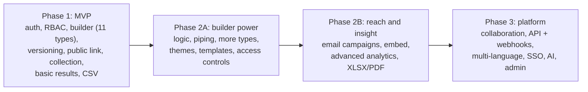

# 4. Phased Roadmap and Acceptance Criteria

> Status: draft for approval. Each phase ends with a demo against its checklist. Items that aren't checked off move
> explicitly to the next phase. They don't silently slip.

## 4.1 Overview

**Suggestion:** Phase 2 as briefed is about as large as Phase 1 and Phase 3 combined. I propose splitting it into
**2A** and **2B** so each delivers something demoable. The two halves have no technical dependency on each other
and can be swapped if email distribution matters more to you than logic.

### Where unassigned items went

The brief assigned some items to phases. I placed the rest here.

| Item | Phase | Reason |
|---|---|---|
| Survey-level sharing (owner, editor, viewer) | 1 | Part of RBAC. Retrofitting permissions is painful. |
| Hidden fields / URL params | 1 | Cheap, and shapes the response schema. |
| Close date, quota, one-per-browser | 1 | Cheap and needed for real use. |
| Duplicate survey | 1 | Small, and useful from day one. |
| Audit event **writing** | 1 | Cheap interceptor. The viewer UI comes in Phase 3. |
| Matrix, ranking, slider, phone, file upload, datetime, consent | 2A | Custom accessible widgets. File upload needs storage and malware scanning. |
| Templates, question bank, password, open date, CAPTCHA | 2A | Builder and access features. |
| Embed widget, tags/notes, XLSX/PDF, scheduled reports | 2B | Distribution and analysis features. |
| Folders, teams, comments, approvals, notifications | 3 | Collaboration, per the brief. |
| Retention, bulk delete, usage, DSAR, super admin console | 3 | Administration. |
| Login-required respondents | 3 | Depends on open question Q5. |
| Production infrastructure as code | open | Open question Q4. |

## 4.2 Phase 1: MVP

### Scope

- **Foundation:**
  - pnpm monorepo (`apps/api`, `apps/web`, `apps/respondent`, `packages/survey-core`, `packages/contracts`, `packages/db`)
  - docker-compose (Postgres 17, Redis 7, Mailpit)
  - `.env.example`
  - lint, format, typecheck
  - `pnpm verify`
  - CI workflow
- **Auth and org:**
  - signup (creates org)
  - email verification, login/logout, password reset
  - invitations with roles
  - member management
  - org switching
- **RBAC:** org roles plus survey sharing, as in the [permission matrix](01-architecture.md#15-authentication-and-authorization).
- **Tenant isolation:** RLS on every tenant table, plus scoped repositories.
- **Builder:**
  - Pages. Drag-and-drop with keyboard support for questions and pages, including moving between pages.
  - Duplicate and delete questions.
  - Question settings panel.
  - Live preview in an iframe, desktop and mobile.
  - Autosave with conflict detection.
  - Validation panel.
  - Thank-you message (text).
- **Question types (10 answerable + text block = 11 element types):**
  - single choice, multiple choice, dropdown
  - short text, long text
  - rating (stars), NPS (0–10), Likert (single statement)
  - email, date
  - text/section block
- **Per-question settings:** required, help text, randomized options, "Other" with free text, min/max selections,
  character limits, built-in format validation (email, date).
- **Versioning:** publish v1, edit live → draft → v2, responses tied to their version, immutable published versions.
- **Distribution:**
  - default public link, plus named links with preset hidden fields
  - declared hidden fields captured from URL params
  - QR code (SVG/PNG)
  - close date, manual close/reopen, response quota
  - one response per browser (best-effort)
- **Respondent app:**
  - mobile-first, WCAG 2.1 AA for every P1 type
  - pages with progress bar, back navigation
  - client and server validation
  - autosave per page, resume in the same browser, retry with backoff
  - closed/quota/not-found pages
  - anonymous mode
  - honeypot and rate limiting
- **Results:**
  - KPIs (started, completed, completion rate, average and median time)
  - drop-off by page
  - per-question charts for P1 types
  - filters for date range, version, include partials, include test responses
  - 15 s polling
- **Responses:** list with status/date filters, detail view, delete.
- **Export:** CSV streaming export, compact and expanded layouts.
- **Ops:**
  - JSON logs with request IDs and PII redaction
  - Sentry (when a DSN is set)
  - `/healthz` and `/readyz`
  - audit events written
- **Seed data:**
  - demo org with one user per role
  - 3 sample surveys (customer NPS, employee pulse, event feedback) with about 500 responses each
  - `pnpm db:seed:large` for a 50 k-response survey
- **Docs:** README (setup on Windows, macOS and Linux, scripts, env vars, architecture links).

### Explicitly not in Phase 1

Conditional logic, piping, themes and branding, templates, question bank, advanced question types, email
distribution, embed, password protection, advanced analytics, tags and notes, XLSX/PDF, collaboration features,
API keys and webhooks, multi-language, SSO, AI summaries.

### Build order

1. Monorepo, tooling, compose, CI skeleton.
2. `packages/db`: schema, migrations, RLS policies, immutability trigger, seed.
3. `packages/survey-core`: definition schema, per-type validation, page navigation, server-side completion check.
   Fully unit-tested.
4. API modules: auth → orgs/members/invitations → surveys/drafts/publish/collaborators → distributions → respondent
   (`/r/v1`) → results → export → audit. Integration tests are written alongside each.
5. Respondent app: renderers per type, paging, autosave, retry, accessibility.
6. Admin app: auth screens → survey list → builder + preview → share panel → results → responses → members.
7. End-to-end tests, performance seed and perf script, Lighthouse budget, README.

### Phase 1 acceptance criteria

**Foundation**
- [ ] On a clean machine, following the README, `docker compose up -d`, `pnpm install`, `pnpm db:migrate`, `pnpm db:seed`, `pnpm dev` bring up the full stack. Tested on Windows and one Unix OS.
- [ ] `pnpm verify` (lint, typecheck, unit and integration tests) passes, and so does `pnpm test:e2e` (headless).

**Authentication and organization**
- [ ] Signing up creates an org with the user as `org_admin`. The verification email arrives in Mailpit.
- [ ] Session cookie is `HttpOnly`, `SameSite=Lax`, and `Secure` outside local dev. A state-changing request without a valid CSRF token gets `403`.
- [ ] Repeated failed logins for one account are throttled. Error messages don't reveal whether an email exists.
- [ ] Password reset token is single-use and expires after 1 h. A reset revokes the user's other sessions.
- [ ] An org admin can invite by email with a role. The invite can be accepted by a new or existing user, expires after 7 days, and can be revoked.
- [ ] An org admin can change roles and remove members. The last `org_admin` can't be demoted or removed.
- [ ] A user in two orgs can switch between them, and each org shows only its own data.

**Authorization and tenant isolation**
- [ ] A table-driven integration test covers every capability × role in the permission matrix.
- [ ] A creator sees only surveys they own or that were shared with them. An analyst can't be made an editor. A viewer can't edit, publish, delete or share.
- [ ] Logged in to org A, every survey, response, distribution and member endpoint returns `404` for org B's IDs, and list endpoints never include org B's rows.
- [ ] A test enumerates every table with `org_id` and asserts RLS is enabled and forced on it.
- [ ] A super admin who isn't a member of an org can't read that org's surveys or responses.

**Builder**
- [ ] A creator can add pages and each of the 11 P1 types, edit text, reorder questions and pages with both mouse and keyboard, move a question between pages, and duplicate or delete questions.
- [ ] Required, help text, randomized options (stable for each respondent across reloads), "Other" with text, min/max selections and character limits all behave the same in the preview and the live survey.
- [ ] The preview reflects an edit within 1 s and switches between desktop and 390 px mobile width.
- [ ] Edits survive a reload. Editing in two tabs produces a conflict prompt rather than a silent overwrite.
- [ ] The validation panel lists issues and jumps to them on click. Publish is blocked while errors exist.

**Publishing and versioning**
- [ ] Publishing creates version 1 and a public link, and the survey becomes `live`.
- [ ] Editing a live survey creates a draft. The public link keeps serving v1 until v2 is published.
- [ ] A respondent who started on v1 before v2 was published finishes on v1, and their response shows version 1.
- [ ] A direct SQL `UPDATE` of a published version's definition is rejected by the database.
- [ ] Results combine v1 and v2 by question. A question removed in v2 still shows its v1 counts, labelled as removed.

**Distribution and access**
- [ ] Named links carry their preset hidden fields. Declared hidden fields are captured from the URL. Undeclared parameters are ignored.
- [ ] The QR code downloads as SVG and PNG and scans to the right link.
- [ ] A close date, manual close or reached quota stops **new** respondents (closed page shown). Respondents already in progress can finish.
- [ ] "One response per browser" blocks a second response from the same browser. Documented as best-effort.

**Respondent experience**
- [ ] Works on current Chrome, Firefox, Safari and Edge, and on iOS Safari and Android Chrome at 360 px width.
- [ ] Validation errors are linked to their fields (`aria-describedby`), announced to screen readers, and focus moves to the first error.
- [ ] axe reports zero serious or critical violations for every P1 type. A manual NVDA or VoiceOver pass through a sample survey is recorded in `docs/a11y-p1.md`.
- [ ] Closing the tab mid-survey and reopening the link resumes on the same page with answers restored.
- [ ] With the network cut while pressing "Next", no answers are lost: the app retries and completes once the network returns. Sending the same save or complete request twice produces exactly one response (integration test).
- [ ] The server rejects a completion missing a required answer, even when the client is bypassed (integration test).
- [ ] Honeypot submissions aren't stored. More than 20 new responses per minute from one IP to one survey get `429`.
- [ ] Anonymous survey: stored rows have no recipient, user or country, timestamps are at hour precision, and a survey containing an email question can't be published.
- [ ] Lighthouse (mobile, simulated slow 4G) on a 15-question survey: LCP < 2 s and JS ≤ 100 KB gzipped, enforced in CI.

**Results and export**
- [ ] The dashboard shows started, completed, completion rate, average and median time, and drop-off by page. A new completion appears within 15 s.
- [ ] Each P1 type has its own visualization: bars or a share bar for choices (a segmented bar instead of a pie, per the data-viz guidance), NPS score with promoter/passive/detractor breakdown, rating distribution with mean, paginated text list, date histogram.
- [ ] Date range, version, "include partial" and "include test" filters all work.
- [ ] Response list and detail view work. A deleted response disappears from all counts within 1 minute.
- [ ] CSV opens correctly in Excel and Google Sheets, including non-Latin text. Compact and expanded layouts work. A formula-injection test passes. Each export is audit-logged.
- [ ] With the 50 k-response seed, the unfiltered summary returns in < 1 s and a date-filtered summary in < 5 s (p95). The perf report is committed (`perf/results-summary.md`).

**Operations**
- [ ] Logs are JSON with a request ID. A test asserts that answer values, emails and tokens never appear in logs.
- [ ] `/healthz` and `/readyz` work. Errors reach Sentry when `SENTRY_DSN` is set; it's a no-op otherwise.
- [ ] Audit rows exist for login, member and role changes, survey create/publish/close/delete, response delete and export.
- [ ] Seed creates one user per role (dev-only credentials documented in the seed file and README) and the 3 sample surveys.

## 4.3 Phase 2A: builder power

**Scope:**

- **Conditional logic:**
  - show/hide questions and pages
  - skip to page, end early, disqualify
  - AND/OR/NOT nested up to 3 levels
  - rule editor and a read-only logic map
- **Piping:** earlier answers, hidden fields/URL params, contact fields.
- **Question types:** matrix, ranking, slider, date-time/time, phone, file upload (S3 + malware scan), consent.
- **Validation:** regex pattern, numeric ranges, date ranges.
- **Themes:** logo, colors, font, default org theme, custom thank-you page, redirect URL with piped parameters.
- **Templates:** global and org templates, save as template, question bank.
- **Access:** password protection, open date, Cloudflare Turnstile CAPTCHA (optional), speed and straight-lining quality flags.

**Acceptance criteria**
- [ ] Logic covers show/hide on questions and pages, skip-to, end and disqualify, using AND, OR and NOT up to three levels. It behaves identically in the preview, the respondent app and the server-side completion check, verified by a shared test-vector suite run in all three.
- [ ] The validator rejects backward jumps, references to later questions, type-mismatched operators and dangling keys, each with a precise message.
- [ ] Answers to questions hidden by logic are discarded on completion and never appear in results or exports.
- [ ] Piping shows earlier answers, URL params and contact fields with a fallback text. Piped values are always rendered as text (an XSS test with HTML payloads passes).
- [ ] Matrix (single and multi per row), ranking, slider, phone (E.164), date-time and consent are keyboard and screen-reader operable. Matrix renders as stacked questions below 600 px.
- [ ] File upload enforces size and type limits server-side. Files are malware-scanned before they can be downloaded. Infected files are quarantined and flagged.
- [ ] A theme (logo, colors, font) applies to the live survey without republishing. Color contrast below WCAG AA is blocked in the theme editor.
- [ ] A custom thank-you page and a redirect URL with appended hidden fields work.
- [ ] Creating from a template, saving as template and inserting from the question bank all produce fresh keys (no collisions).
- [ ] A password-protected survey can't be read through the API without unlocking it. An open date shows the "not yet open" page.
- [ ] With CAPTCHA enabled, submissions without a valid token are rejected. Quality flags are visible in the response viewer and can be filtered on.
- [ ] The respondent bundle still meets the Phase 1 budget (new widgets are code-split).

## 4.4 Phase 2B: reach and insight

**Scope:**

- **Contacts:** CSV import with column mapping, dedupe and an error report. Lists.
- **Email campaigns:**
  - personalised unique links, scheduled sends
  - reminders to non-responders
  - unsubscribe, SES bounce and complaint handling
  - one response per recipient
  - email resume link
- **Embed widget:** inline and popup.
- **Analytics:**
  - filters and segments (same grammar as logic)
  - cross-tab with chi-square
  - drop-off by question
  - word cloud, matrix heatmap, ranking charts
  - SSE live updates
- **Response viewer:** full-text search, tags, notes, bulk delete.
- **Exports:** async XLSX and PDF report exports, scheduled report emails.

**Acceptance criteria**
- [ ] Importing a 50 k-row CSV completes in < 2 minutes with a downloadable error report. Duplicates by email are merged.
- [ ] A scheduled campaign sends at the set time in the creator's timezone. Each recipient gets a unique link. Reminders go only to non-responders and stop at the configured maximum.
- [ ] An unsubscribe link works without login, and unsubscribed or bounced contacts are never emailed again.
- [ ] A recipient token can be used for one response only. A second visit shows "already responded", or resumes if the response is incomplete.
- [ ] In anonymous surveys, campaign tracking marks recipients as responded **without** linking the response (verified in the database).
- [ ] The embed snippet works inline and as a popup on a test page with a strict CSP. Host-page CSS doesn't leak into the survey.
- [ ] Filters (answer, hidden field, date, status, version, tag, device) and up to 4 side-by-side segments work. Results on the 50 k seed come back in < 5 s (p95).
- [ ] Cross-tab of any two choice-like questions shows counts, row and column percentages, and chi-square.
- [ ] Drop-off by question, word cloud, matrix heatmap and ranking charts render correctly against fixture data with known answers.
- [ ] The dashboard updates within 3 s of a completion via SSE, and falls back to polling.
- [ ] Response search finds text in open answers. Tags and notes work. Bulk delete by filter is audit-logged and repairs aggregates.
- [ ] XLSX matches the CSV content. The PDF report contains a chart for each question plus the KPIs. A 50 k-response XLSX export completes in < 2 minutes.
- [ ] Scheduled reports arrive on schedule with the chosen format and filters.

## 4.5 Phase 3: platform

**Scope:**

- **Collaboration:**
  - folders, teams
  - comments on drafts
  - configurable approval before publish
  - audit-log viewer
  - email and in-app notifications: new response, NPS detractor, threshold, closing
- **Public REST API:** API keys with scopes, curated OpenAPI docs, idempotency keys, outgoing webhooks.
- **Multi-language surveys:**
  - translation editor, CSV import/export of strings
  - language picker plus browser detection
  - missing-translation checks
  - right-to-left support (see risks)
- **Integrations:** a Slack notifier (incoming webhook) built for real. HubSpot and Google Sheets connectors defined as interfaces with stubs.
- **AI summaries of open text:** themes and sentiment, opt-in per org, labelled, with cost caps.
- **SSO:** SAML and OIDC, just-in-time provisioning, optional SSO enforcement.
- **Administration:** retention policies and purge, bulk delete, usage metrics, super admin console.
- **Privacy:** subject export and erasure (GDPR/CCPA).
- **Login-required respondents:** pending Q5.

**Acceptance criteria**
- [ ] Folders (3 levels), drag-to-move, and teams usable in survey sharing.
- [ ] Comments can be anchored to a question, threaded and resolved. Comments aren't visible to respondents.
- [ ] With approvals on, publishing creates a request. Only an org admin or designated approver can approve. An approved version publishes exactly the reviewed revision; any later edit invalidates the approval.
- [ ] The audit-log viewer filters by actor, action, entity and date, and exports CSV. Audit rows can't be modified by the app's database role.
- [ ] Notification rules fire once per event (no duplicates on job retry) and respect each user's channel preferences.
- [ ] API keys are shown once, stored hashed, scoped and revocable. Calls outside a key's scope return `403`. The OpenAPI document validates, and a generated client passes a smoke test.
- [ ] Replaying a POST with the same `Idempotency-Key` returns the original result without a duplicate.
- [ ] Webhooks are signed (a sample verifier in docs passes), retried on the documented schedule, viewable with every attempt, redeliverable, auto-disabled after repeated failure, and blocked from private IP ranges (SSRF test).
- [ ] A survey translated into 2 languages serves each by `lang` param and by browser detection. Logic and piping work in every language. Publish warns about missing strings. A right-to-left language renders mirrored.
- [ ] The Slack notifier posts new-response and detractor alerts. HubSpot and Google Sheets connectors have interfaces, configuration UI and contract tests against mocks.
- [ ] AI summaries:
  - off until an org admin opts in
  - every output labelled "AI-generated" with model and date
  - shows the count of responses analysed
  - links each theme to sample responses
  - respects a per-org monthly token cap
  - redacts emails and phone numbers before sending
- [ ] SAML (tested with Okta or Entra ID) and OIDC (tested with Google) logins work with just-in-time provisioning. Enforced SSO blocks password login for that org's domains.
- [ ] A retention policy purges responses older than N days on schedule, repairs aggregates and writes an audit entry.
- [ ] Usage metrics per org are visible to org admins and super admins.
- [ ] A subject export request produces a file of every non-anonymous record for an email. Erasure removes them and is audit-logged. Anonymous responses are, correctly, out of scope.

## 4.6 Definition of done (every phase)

- [ ] All acceptance criteria checked off or explicitly deferred with a reason.
- [ ] `pnpm verify` and end-to-end tests green. No new axe serious or critical violations. Bundle and performance budgets met.
- [ ] Migrations are forward-only and tested from the previous phase's schema with data present.
- [ ] Docs updated (README, API docs, this roadmap).
- [ ] No secrets in the repo. Dependency audit has no high or critical issues.
